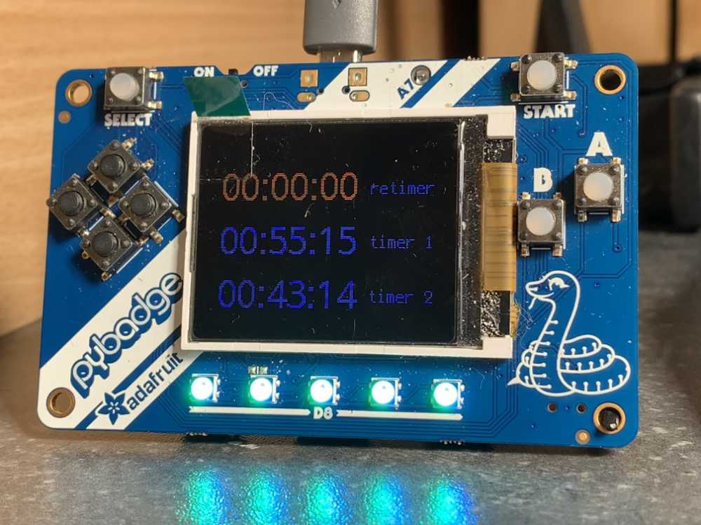

# Retimer

A kitchen timer that counts down the total cooking time and, above all, reminds
you at regular intervals to act on the food: toss the grilled vegetables, baste
the roast, fold the bread dough.

Retimer is a physical device, with its own electronics and firmware. No app, no
phone.

## Version 1 (2020): the PyBadge prototype

When I grill vegetables, I need a regular reminder to check on the food. I used
to set my kitchen timer to 5 minutes and restart it every time it went off.
Except I often forgot to restart it. The first Retimer was a quick prototype to
test a better workflow: a timer that re-triggers by itself.



It ran on an off-the-shelf [Adafruit PyBadge](https://www.adafruit.com/product/4200)
in CircuitPython 5.3, with:

- one repeating "retimer" and two one-shot timers, set with the d-pad;
- hands-free acknowledgement by covering the light sensor;
- NeoPixels and the speaker for alarms.

What it proved: a timer that keeps reminding you is genuinely useful in the
kitchen. What it also showed:

- no sleep mode, so the battery drains quickly;
- three fixed timers are less natural than one total timer plus one reminder;
- the light sensor is unreliable in a dim kitchen;
- the code is tied to CircuitPython 5.3: it still runs on the original board,
  but a new board with a current CircuitPython would need a port.

The prototype is archived under the [`v1.1` tag](https://github.com/psol/retimer/tree/v1.1)
(`git checkout v1.1`). It is no longer maintained.

## Version 2 (in progress)

The new Retimer is designed from a written specification. Its goals:

- **Two timers**: a total timer, plus an optional reminder that repeats during
  the countdown, measured from the moment you acknowledge it.
- **No modes, no start button**: you turn the knobs, and the countdown starts by
  itself a few seconds after you stop. Turning the total back to zero stops it.
  Both timers can be adjusted while counting down.
- **Unobtrusive alerts**: a short beep sequence once, then a silent visual alert
  until you acknowledge it, so you can tell when you missed one.
- **Long battery life**: the microcontroller sleeps between events and is woken
  by a hardware timer or a user action.
- **Everything on the device**: no app, no connection.

The first hardware is a provisional, tactical choice: an
[M5Stack CoreInk](https://docs.m5stack.com/en/core/coreink) (ESP32, 1.54" e-ink
display, three-way wheel, buzzer) that was available at no cost. It is a way to
find out, in real kitchen use, whether e-ink suits a timer. If it doesn't, the
next step is a custom build with a Sharp Memory LCD and two rotary encoders.

Firmware: C11 on ESP-IDF. The timer logic is independent from the hardware and
is unit-tested on the development machine. The whole toolchain runs natively on
Apple Silicon Macs, without Rosetta.

Project documents (in French):

- [SPEC.md](SPEC.md): the requirements, each with a stable identifier;
- [docs/PLAN.md](docs/PLAN.md): the development plan, tests and field trials;
- [CLAUDE.md](CLAUDE.md): working rules, hardware choice and software architecture;
- [docs/comparaison-materiel.md](docs/comparaison-materiel.md): hardware comparison.

## Built with AI

Version 2 is developed with an AI coding assistant,
[Claude Code](https://claude.com/claude-code). This is a deliberate choice for a
one-person hobby project: the assistant drafts specifications, compares
hardware, writes code and tests, while the human decides, reviews and cooks.

The method is meant to keep the human in control:

- **Specification first.** Requirements are written and agreed in SPEC.md before
  any code. Each one has a stable identifier (`DEM-01`, `ACQ-04`…) quoted in
  commits, pull requests, tests and code comments, so every line can be traced
  back to a decision.
- **Written working rules.** CLAUDE.md tells the assistant how to work on this
  repository: what it may change, what it must ask about first.
- **Human review.** Every change goes through a pull request reviewed by the
  author before it reaches `master`.
- **Tests before trust.** The timer logic is covered by automated tests; the
  device itself is validated by a person using it in a real kitchen.

## Project layout

| Path | Content |
|---|---|
| `components/constants`, `adjust`, `kitchen_timer`, `render` | Timer logic and screen rendering. Plain C11, no hardware dependency, unit-tested on the development machine. |
| `components/input`, `eink_display`, `signals`, `power` | CoreInk drivers: buttons, e-ink display, buzzer and LED, sleep and power. |
| `main/` | Firmware entry point: wires the components together. |
| `test/host/` | Host unit tests (Unity, CMake), with reference screen images. |
| `docs/` | Plan, hardware notes. |

## Building

The firmware uses [ESP-IDF v5.4.1](https://docs.espressif.com/projects/esp-idf/en/v5.4.1/esp32/get-started/),
whose tools are published natively for Apple Silicon.

```
. ~/esp/esp-idf/export.sh
idf.py set-target esp32
idf.py -p /dev/cu.usbserial-XXXX build flash monitor
```

Check that the toolchain is native: `file $(which xtensa-esp32-elf-gcc)`
must say `arm64`.

## Running the tests

The timer logic is tested on the development machine, no board needed:

```
cmake -S test/host -B test/host/build
cmake --build test/host/build
ctest --test-dir test/host/build --output-on-failure
```

Each test is named after the requirement it checks (`test_ECH_05_…`).
Screen tests will compare the rendered images with reference images.

GitHub Actions runs the host tests on macOS arm64 and builds the firmware.

## License

See [LICENSE](LICENSE).
